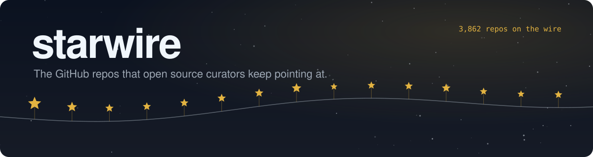

# InfnityRepo

<p align="center">
  
</p>

<p align="center">
  <strong>A curated, daily-refreshed catalog of open source repositories worth a look.</strong><br>
  <sub>3,800+ repos · 15 areas · Trending, new picks, and alternatives — all in one place.</sub>
</p>

<p align="center">
  <a href="https://starwire.foo"></a>
  <a href="https://github.com/infinityalgoacademy-lang/InfinityRepo"></a>
  <a href="LICENSE"></a>
</p>

---

## ✨ Features

- **Trending & new picks** — repos gaining stars fastest for their size, refreshed daily
- **15 areas** — AI & agents, Developer tools, Web & frontend, Infrastructure, Data, Security, and more
- **Vital signs** — commits, releases, issues, momentum, and a 5-point signal check per repo
- **Alternatives pages** — open source replacements for popular paid tools (Notion, Figma, Postman…)
- **Collections** — curated stacks for solopreneurs, founders, and indie hackers
- **Saved for later** — bookmark repos in your browser, no account needed
- **Share cards** — copying a share link gives `/r/<owner>/<name>` on the site itself, with a rich preview image for every repo

## 🖼️ Share previews

The share buttons copy a link to the site's own preview route, e.g. `https://<site>/r/<owner>/<name>`. That route
(`docs/_worker.js`, a Cloudflare Pages advanced-mode worker) writes the page's Open Graph tags and renders the card at
`/r/<owner>/<name>/card.png` with the same renderer as the share worker (`share/src/card.js`), so chat apps and social
sites show the repo's stars, gain and vital signs. It needs Cloudflare Pages: a purely static host (GitHub Pages,
`python3 -m http.server`) serves the app but not those two routes. The `r.starwire.foo` worker still serves standalone
share cards and README badges.
- **Weekly newsletter** — trending repos, new picks, hidden gems, and "instead of" spotlights
- **RSS feeds** — daily top picks and every new pick
- **Dark / light themes** — with system preference support

## 🗂️ Structure

```
InfnityRepo/
├── docs/                  # Static site (Cloudflare Pages)
│   ├── index.html         # Main app
│   ├── how.html           # How it works
│   ├── _worker.js         # /r/... preview pages and card images
│   ├── css/style.css      # All styles
│   ├── js/                # Client-side app (app.js, repo.js, search.js, …)
│   └── data/              # data.json, vitals.json, fit.json, art.json
├── share/                 # Cloudflare Worker for share cards & badges
│   ├── src/               # card.js, badge.js, altcard.js, art.js
│   ├── pages/             # The same cards, served by the Pages worker
│   └── preview.mjs        # Local card preview
├── newsletter/            # Weekly email builder
│   └── newsletter.mjs
├── scripts/               # Automation (add-repos.mjs)
├── lists/                 # Markdown lists per area
└── .github/               # CI (Pages deploy, newsletter preview)
```

## 🚀 Quick start

### Run the site locally
```bash
node .github/stamp.mjs docs _site
cd _site && python3 -m http.server 8080
```
Open http://localhost:8080

### Preview the share cards locally
```bash
cd share && npm install          # once
npx wrangler pages dev ../docs --port 8790
```
Open http://localhost:8790/r/owner/name — the meta refresh sends a browser on to the app page, so view the HTML or the
`/r/owner/name/card.png` image directly. The plain static server above does not run these routes.

### Build the newsletter preview
```bash
node newsletter/newsletter.mjs
# writes newsletter.html — open in a browser
```

### Preview share cards
```bash
cd share && npm install && node preview.mjs cards "owner/repo"
```

### Add repositories (automated)
```bash
node scripts/add-repos.mjs owner/repo owner/repo
# or pull from GitHub search:
node scripts/add-repos.mjs --search "stars:>5000" --pages 3
```

## 🛠️ Tech stack

| Layer | Tech |
|-------|------|
| Site | Vanilla JS, CSS (no framework), static HTML |
| Hosting | GitHub Pages |
| Share cards | Cloudflare Workers + `@cf-wasm/og` |
| Newsletter | Node.js (no deps), listmonk |
| Data pipeline | Python + GitHub API |
| Styling | Geist font, OKLCH color tokens, dark/light themes |

## 📊 Data

All repository data lives in `docs/data/data.json` (compacted format). Each entry includes stars, forks, language, license, topics, areas, vital signs inputs, and more. The site is fully client-side — filters, search, and sorting all run in the browser.

## 🤝 Contributing

- **Submit a repo**: use the [submission form](https://github.com/boffti/starwire/issues/new?template=submit-repo.yml)
- **Report a bug**: [bug report template](https://github.com/boffti/starwire/issues/new?template=bug-report.yml)
- **PRs welcome** — see [CONTRIBUTING.md](CONTRIBUTING.md)

## 📄 License

The list and its data are [CC0 1.0](LICENSE) — free to build on, no credit needed.

---

<p align="center">
  <sub>Built with ❤️ by the open source community.</sub>
</p>